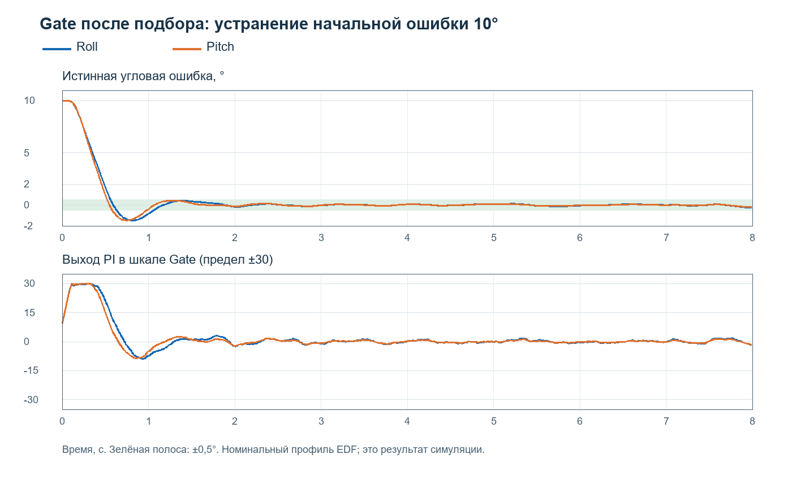

# Подбор Gate на профилях EDF — 24.10.2026

Для дальнейших испытаний в FModel выбран общий набор Roll/Pitch:

| Параметр | Исходный | Подобранный |
|---|---:|---:|
| N | 4 | **1,1** |
| LeadTime, с | 0,4 | **0** |
| KLambda, 1/с | 0,5 | **5,4** |
| MaxRate | 90 | **30** |
| FilterTime, с | 0,15 | **0,06** |
| RateKp | 4 | **0,25** |
| RateKi, 1/с | 20 | **6,8** |
| SensorDelay, отсчётов | 3 | **0** |

Это лучший найденный округлённый набор для явно заданного критерия на текущей
приближённой модели, а не доказанный глобальный оптимум или готовая полётная настройка.
Формулы регулятора, исходные значения в программе, рабочий INI и прошивка не изменялись.

## Как проверить в FModel

Открыть Ctrl+S → «По записи EDF»: выбрать 1 (Roll) или 2 (Pitch), остальные
параметры этой вкладки оставить исходными. На вкладке **«СВП»** (исходный Gate,
не «СВП+») ввести восемь значений из таблицы. Величины используют прежнюю шкалу Gate.
При отсутствии дальномера для воспроизведения приведённого геометрического опыта
установить «Заморозка по дальности» = 0. Сам подбор углового контура выполнялся
с FreezeRequested=False. Настройка фиксации команды по дальности в подбор не входила.

Фрагмент INI: [rounded.ini](../profiles/EDF-20261023/Gate-tuning/rounded.ini).
Это только секция GateNavigation: не заменять им целиком существующий FModel.ini.
Нулевой SensorDelay относится к входу с уже выполненной поправкой по гироскопу
и к реализованной в профиле временной обработке. Физические задержки объекта
70/60 мс и камеры 35 мс остаются в модели, их ноль SensorDelay не отменяет.

## Что изменилось в реакции

| Номинальный опыт: начальная ошибка 10°, 8 с | Roll | Pitch |
|---|---:|---:|
| Время входа в ±0,5° без дальнейшего выхода | 1,06 с | 0,99 с |
| RMS ошибки в последние 2 с | 0,076° | 0,060° |
| Перерегулирование после перехода через ноль | 1,48° | 1,46° |
| Максимум физической угловой скорости | 23,32°/с | 26,63°/с |
| Доля выхода на предел команды | 0% | 0,5% |
| Доля времени выше 95% предела команды | 3,88% | 3,38% |

Исходный Gate в этом же опыте не установился за 8 с: остаточная RMS ошибки
12,84° / 10,91°, насыщение 91,6% / 96,0%.



На расширенной проверке, по 168 опытов для каждого набора:

| Показатель, среднее по опытам | Исходный | Осторожный диагностический | Подобранный |
|---|---:|---:|---:|
| RMS угловой ошибки за весь опыт | 11,46° | 7,61° | 2,63° |
| RMS ошибки в последние 2 с | 11,29° | 6,13° | 0,34° |
| Доля насыщения команды | 92,0% | 0% | 1,3% |

Диагностический набор из прежнего отчёта: N=1, Lead=0, KLambda=0,5,
MaxRate=20, FilterTime=0,15, RateKp=0,5, RateKi=0, SensorDelay=0.
Он устойчив в этих опытах, но слишком медленно устраняет ошибку.

Худшая RMS в последние 2 с у подобранного набора — 1,56°: это опыт со сменой
направления и ослабленным объектом. Для постоянного направления худшая остаточная
RMS — 0,344°. Максимальное насыщение отдельного опыта — 12,6%; максимум гироскопа
по всей проверке — 37,76°/с. Следовательно, MaxRate=30 ограничивает задание и
выход PI в его шкале, но не гарантирует физический предел гироскопа 30°/с.

Снижение RateKp уменьшило усиление быстрого контура при задержке объекта.
Интегратор оставлен: он устраняет ошибку скорости при нелинейном преобразовании RC.
Увеличение KLambda ускоряет устранение угловой ошибки. N близко к 1 подходит
для проверенных плавно меняющихся направлений; член второй производной LeadTime
в найденном решении отключён. Это результат поиска целого набора, а не основание
менять любой из этих коэффициентов отдельно без повторной проверки.

## Критерий и воспроизводимость

Использованы реальные TGateController и TRecordedPlant из проекта, без переписывания
формул в другом языке. Статическая/динамическая модель зафиксирована до подбора.
Seed поиска = 20261024. Проверены 1800 кандидатов: широкий случайный поиск,
затем преимущественно локальные изменения лучшего набора; каждая пятая проба
остаётся широкой. Доказательства глобального оптимума такой поиск не даёт.

Обучающие сценарии: две оси × четыре направления × два состояния объекта = 16.
Направления: постоянные ошибки 1°, 10°, 25°; `5 + 8*sin(1,2*t)` градусов.
Продолжительность 6 с, dt=0,01 с, Seed шума 20261023.
Состояния: номинал и совместно усиление ×1,2, дополнительная задержка 20 мс,
частота динамики ×0,85, камера 50 мс, шум ×1,5.

Для каждого опыта вычислялась стоимость:

`J = IAE/(T*S) + 1,5*RMS_last2s/S + 0,35*sat + 0,004*TV(u)/T + 0,4*max(0,peak_error/S − 1)`.

Здесь `S=max(5°,abs(начального направления))`, IAE — интеграл абсолютной истинной
угловой ошибки, sat — доля насыщения, TV — сумма модулей приращений выхода.
Насыщение во всех таблицах определено как `abs(Output) >= MaxRate − 0,001`.
Этот показатель не включает приближение к пределу и не измеряет насыщение
внутреннего CommandRate; для номинального перехода отдельно дана доля выше 95%.
Итог поиска: средняя J + 0,35*худшая J по 16 опытам. Веса задают компромисс,
а не являются физическими константами. Стоимость неокруглённого лучшего набора
0,479506, округлённого — 0,482712, ухудшение около 0,67%.

Границы локального поиска: N 0…4, LeadTime 0…0,3 с, KLambda 0,3…10,
FilterTime 0,03…0,8 с, RateKp 0,02…1,5, RateKi 0,05…12, MaxRate 20…60
с шагом 5, SensorDelay 0…3. Полный порядок генерации кандидатов сохранён в коде.

Проверка после подбора: две оси × семь направлений × шесть состояний × два новых
Seed = 168 опытов по 8 с. Добавлены смена направления 0°→15° в 2 с→−5° в 5 с,
нарастание 3°/с и постоянное −12°. Seed шума 20262001/20262002.
К двум состояниям обучения добавлены:

- Усиление ×0,75, частота ×0,8, камера 20 мс, шум ×2.
- Усиление ×1,35, добавочная задержка 30 мс, демпфирование ×0,8, камера 60 мс, шум ×2.
- Камера без физической задержки и без шума; поправка по гироскопу остаётся 35 мс.
- Камера 70 мс, шум ×2, шаг 5 мс.

После этой проверки набор не изменялся. Часть сценариев отличается только шумом,
длительностью или возмущениями; это не 168 независимых физических испытаний.
Поиск и проверка не учитывали постоянное смещение камеры, пропуски детектора,
ветер, связи осей и изменение режима полётного контроллера.

## Отдельная проверка геометрии ворот

Без дополнительного подбора проведены 36 сценариев на набор: две оси × углы
5°/10°/15° × скорости 20/50 км/ч × CourseTime 0,2/0,5/0,8 с.
Плоскость ворот x=100 м, центр y=100*tan(начального угла), ворота неподвижны,
заморозка отключена. Измерен поперечный промах первого пересечения плоскости,
а не минимум после повторных разворотов. Горизонт 40 с.

Оба набора пересекли плоскость в 36/36 сценариях. У исходного Gate средний модуль
промаха 3,27 м, максимум 9,10 м. У подобранного — 0,0052 м и 0,0174 м.
Последние малые числа характеризуют только идеализированную геометрию стенда:
по ним нельзя заявлять сантиметровую точность реального пролёта. Модель не содержит
реального ветра и ошибок геометрии, а CourseTime из записи не идентифицирован.

## Файлы и ограничения применения

- [Исходные результаты](../profiles/EDF-20261023/Gate-tuning/validation.csv).
- [Геометрическая проверка](../profiles/EDF-20261023/Gate-tuning/geometry.csv).
- `tests/GateRecordedTuning.dpr` — повторить поиск; аргумент — каталог результата.
- `tests/GateGeometryCheck.dpr` — проверить rounded.ini в указанном каталоге.
- [Описание исходной модели и ошибки идентификации](RECORDED_PROFILE_20261023.md).

Пример после сборки Delphi, запуск из корня проекта:

```text
Win32\GateRecordedTests\GateRecordedTuning.exe C:\Temp\GateSearch
Win32\GateRecordedTests\GateGeometryCheck.exe C:\Temp\GateSearch
```

Для сборки используются те же Win32/VCL пути, что в tools/test_recorded.ps1;
у этих двух консольных программ требуется явный аргумент каталога результата.
Повторный поиск перезаписывает только результаты в переданном каталоге.
Готовый запуск обеих проверок: `./tools/tune_gate_recorded.ps1`.
Он по умолчанию пишет результат в `Win32/GateRecordedTests/results`.
Повторная сборка и запуск этого сценария воспроизвели все восемь файлов результатов
первого расчёта побайтно, включая подобранные параметры, CSV и трассы.

Следующий эксперимент на реальном стенде должен подтвердить знаки, временную
обработку входного угла и отклик при этом наборе. Ошибка исходной идентификации
гироскопа остаётся существенной (71°/с Roll, 50°/с Pitch на отложенной части записи).
Успешная симуляция сама по себе не подтверждает безопасность и качество полёта.
