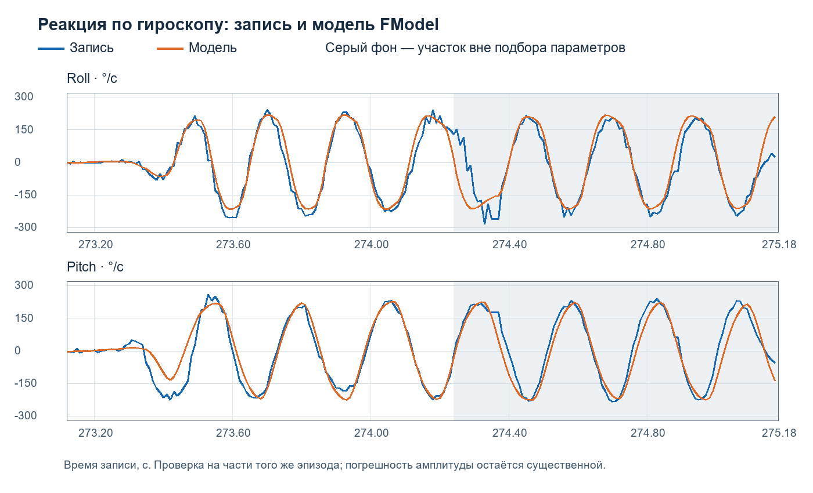

# Модель объекта по записи 23.10.2026

В FModel добавлен общий объект управления и измерительный тракт по записи EDF.
Он реагирует на новые команды регулятора; записанные углы не подставляются в
замкнутый расчёт. Профиль предназначен для исследования устойчивости и сравнения
регуляторов. Точное воспроизведение пространственной траектории полёта не заявляется.

## Включение

1. Запустить `Win32\Debug\FModel.exe`.
2. Открыть параметры (Ctrl+S), вкладку **«По записи EDF»**.
3. Установить **Модель = 1** для Roll или **2** для Pitch, применить настройки.
4. Запустить расчёт обычным способом. Повторная инициализация сбрасывает состояние
   объекта и генератор шума. Заголовок окна показывает выбранный профиль.

Профиль 0 сохраняет прежнее поведение. Настройка сохраняется в секции
`[RecordedPlant]` обычного INI приложения. Существующий INI при установке не меняется.
Roll и Pitch — два отдельных плоских опыта: это не одновременная трёхмерная модель.
Выбранный объект и одинаковая последовательность шума применяются ко всем четырём
регуляторам: PID, Adaptive, Gate и Gate+. Формулы регуляторов не изменены.

## Восстановленная реакция по гироскопу

Команда `u` имеет прежнюю номинальную шкалу FModel. В прошивке она преобразуется
в RC с коэффициентом 2,5 мкс на единицу. Поэтому `p = clamp(u, −120, 120) / 2`
— процент половины диапазона RC, а не измеренная угловая скорость.

Статическая характеристика: `r_inf = L*p + C*p^3`, в градусах в секунду.
Динамика угловой скорости `r` описана вторым порядком с задержкой команды:

`r'' + 2*zeta*omega*r' + omega^2*r = omega^2*r_inf(t − delay)`,
где `omega = 2*pi*f`. Для постоянной команды на шаге используется точное решение.

| Параметр | Roll | Pitch |
|---|---:|---:|
| L | 1,27750595 | 1,41521828 |
| C | 0,00112717235 | 0,00130267125 |
| Частота f, Гц | 6,75 | 4,50 |
| Демпфирование zeta | 0,500 | 0,575 |
| Задержка команды, с | 0,070 | 0,060 |

Знак Pitch при идентификации приведён к гироскопу Y: записанный RC Pitch
инвертирован. В самой плоской модели обе оси имеют согласованный положительный знак.
Нельзя прибавлять к этой задержке задержку возвращаемой MSP-телеметрии RC:
для динамической подгонки использован локальный выход `SOL_FilterRoll/Pitch`.

## Измерения и общие параметры

По умолчанию камера выдаёт 60 сообщений/с, с квантованием 0,01° и эффективным
нормальным шумом sigma 0,18° для Roll / 0,13° для Pitch. Это оценка быстрых остатков
камерного сигнала, содержащих движение; чистый шум детектора из записи не выделен.
Нормальный белый шум — упрощение, выбросы и корреляция ошибок им не воспроизводятся.
Отдельный шум гироскопа не добавлен: его нельзя надёжно отделить от движения.

Физическая задержка камеры по умолчанию 35 мс — проверяемое предположение, а не
результат независимого измерения. Поправка `угол − Gyro*0,035` моделирует обработку
Orange в прошивке. Она задаётся отдельно от физической задержки. Между сообщениями
учитывается изменение ориентации корпуса при сохранённом направлении наблюдения.
Параметр SensorDelay самого Gate остаётся отдельной настройкой регулятора:
его нельзя автоматически считать равным задержке камеры после компенсации.

| Настройка профиля | По умолчанию | Назначение |
|---|---:|---|
| Множитель RC-характеристики | 1 | Разброс усиления объекта |
| Дополнительная задержка | 0 с | Добавка к 70/60 мс |
| Множитель частоты / демпфирования | 1 / 1 | Разброс динамики |
| Частота сообщений камеры | 60 Гц | Дискретные обновления угла |
| Физическая задержка камеры | 0,035 с | Запаздывание измерения |
| Поправка угла минус Gyro × время | 0,035 с | Обработка полученного угла |
| Множитель эффективного шума | 1 | 0 отключает шум |
| Seed | 20261023 | Воспроизводимость после сброса |
| Время изменения курса | 0,4 с | Геометрическое предположение |
| Общее смещение датчика | 0° | Одинаковое смещение для четырёх моделей |

При активном EDF-профиле прежние индивидуальные ActuatorTime/SlipTime и
параметры задержки/смещения датчиков заменяются общим трактом профиля.
Кнопки смещения только PID отключены; используйте общее смещение на новой вкладке.
Задержки и фильтры внутри самих регуляторов продолжают действовать.
Постоянная изменения курса 0,4 с не восстановлена из гироскопа: гироскоп измеряет
вращение корпуса, а не направление скорости. Начальное скольжение общее, нулевое.
Поступательная скорость, движение ворот и остальные условия сцены задаются отдельно.

## Данные и проверка точности

Источник: `C:\Project\FlyLab\Анализ трассы\log_20261023_135632_900_0003.EDF` (300 с, 100 Гц).
SHA-256: `3bf4bada46cf02a62b11490c96d3a73290e2470dd98f7fa339a809fd528bf2c2`.

Статическая кривая построена по медианам групп ручного управления `AUX1 < 1000`:
отброшены по 0,5 с около переключений, первые 3 с и участки Throttle <= −60.
RC из MSP запаздывает относительно гироскопа, поэтому при группировке применены
сдвиги −30/−20 мс (Roll/Pitch). Эти сдвиги не являются физической задержкой объекта.
Автоматическое управление с видимой целью определяется условием
`AUX1 > 1750` и `MV.Orange.Valid = 1`.

Для динамики взят фактический эпизод Gate 273,12–275,18 с. Параметры подобраны
только на 273,12–274,24 с; первые 80 мс исключены из ошибки подбора из-за неизвестной
предыстории. Остаток 274,24–275,18 с не участвовал в подборе.

| Проверка гироскопа | Roll | Pitch |
|---|---:|---:|
| RMSE подбора, °/с | 33,09 | 50,49 |
| RMSE отложенного участка, °/с | 70,77 | 50,27 |
| Корреляция отложенного участка | 0,904 | 0,960 |



Это отложенная часть того же короткого эпизода, не независимый испытательный полёт.
Расхождение особенно существенно у Roll. При больших командах статическая кривая
Roll выходит за хорошо представленный ручными данными диапазон примерно 33% RC;
это экстраполяция. Корреляция формы колебаний не означает точного совпадения амплитуд.

Отдельный замкнутый опыт с неподвижным направлением на ворота и начальной ошибкой
1° воспроизводит выход исходного Gate на ограничения примерно 85% времени за 3 с
(84,7% Roll / 85,0% Pitch). Записанные углы в этот опыт не подаются.
Диагностический вариант Kp=0,5, Ki=0, N=1, Lead=0, Max=20, SensorDelay=0
в том же опыте не насыщается, но реагирует медленно. Это проверка устойчивости,
не готовая настройка полёта и не доказательство точности прохождения ворот.

Для сравнения регуляторов сохраняйте одинаковые начальные условия и Seed.
Дополнительно проверяйте чувствительность к усилению, задержке, шуму и CourseTime;
оценка только на номинальном профиле слишком оптимистична.
Нужна независимая запись с безопасными ступенчатыми/плавными ручными командами,
синхронными RC на входе FC, гироскопом, временем кадра и оценкой скорости движения,
чтобы уточнить объект и геометрию. Связи между осями, аэродинамика и ветер пока отсутствуют.

## Воспроизводимость и сопровождение

Реализация общего объекта: `uRecordedPlant.pas`. Для программного использования
сначала инициализируйте параметры через `DefaultRecordedPlantParameters`, затем
задайте Profile и вызовите Reset. В Gate/Gate+ метод Reset восстанавливает прежний
профиль 0 для совместимости старых вызывающих программ; общий профиль назначайте
после Reset, как это делает uMain. Шаг объекта: `0 < dt <= 0,02 с`; GUI использует
шаг до 0,01 с. Нулевой шаг не меняет состояние. При слишком малом шаге и большой
задержке исчерпание истории из 512 отсчётов выдаёт явную ошибку.

Повторная идентификация (Python + NumPy):

```powershell
python tools/fit_recorded_profile.py "C:\Project\FlyLab\Анализ трассы\log_20261023_135632_900_0003.EDF" --output profiles/EDF-20261023-refit
```

Утилита рассчитана на данную запись и фиксированные интервалы. Она сохраняет
коэффициенты и CSV, но не изменяет константы Delphi автоматически. Её повторный
запуск по исходному EDF воспроизвёл `fit.json` без расхождений.

Сборка и 12 выбранных проверок (Delphi 12, путь к компилятору настраивается):

```powershell
./tools/test_recorded.ps1
```

Пройдены RecordedPlantTest, RecordedIntegrationTest, MotionModelTest,
SharedMotionTest, GateNavigationTest, GateControllerTest, GatePlusIntegrationTest,
ParameterDefaultsTest, HistoryTest, GateSettingsTest, IntegratorTest и AdaptiveGlideTest.
Проверены задержка, знак, пределы, воспроизводимость шума, частота камеры,
соответствие расчёта Delphi расчёту Python (не хуже 0,001°/с), замкнутый опыт,
общие настройки четырёх моделей, сброс/история и сохранение/загрузка параметров.
Это выбранный набор проверок; перечисленные ранее в README несоответствия старых
тестов данной доработкой не исправлялись. Визуальная проверка новой вкладки не заявляется.
